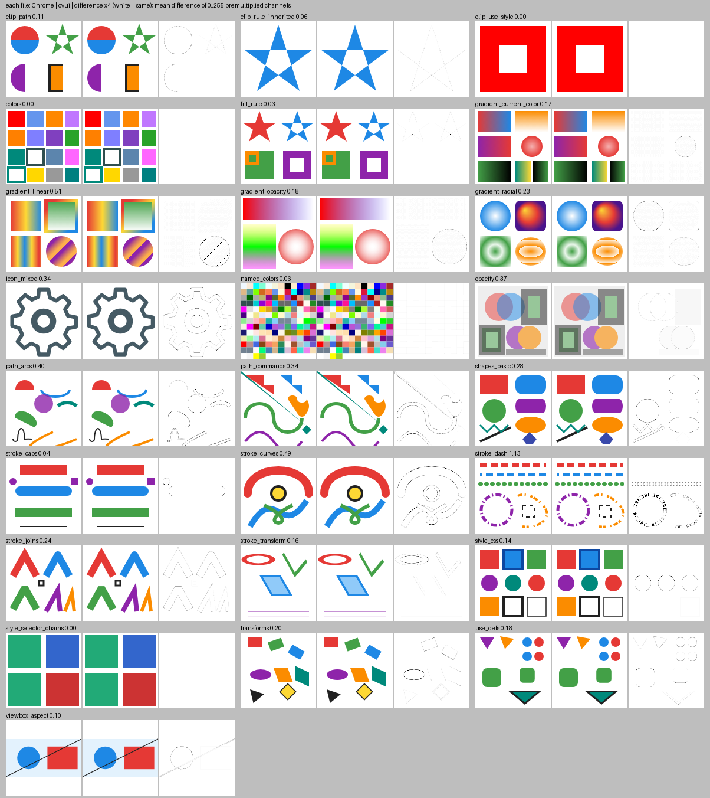
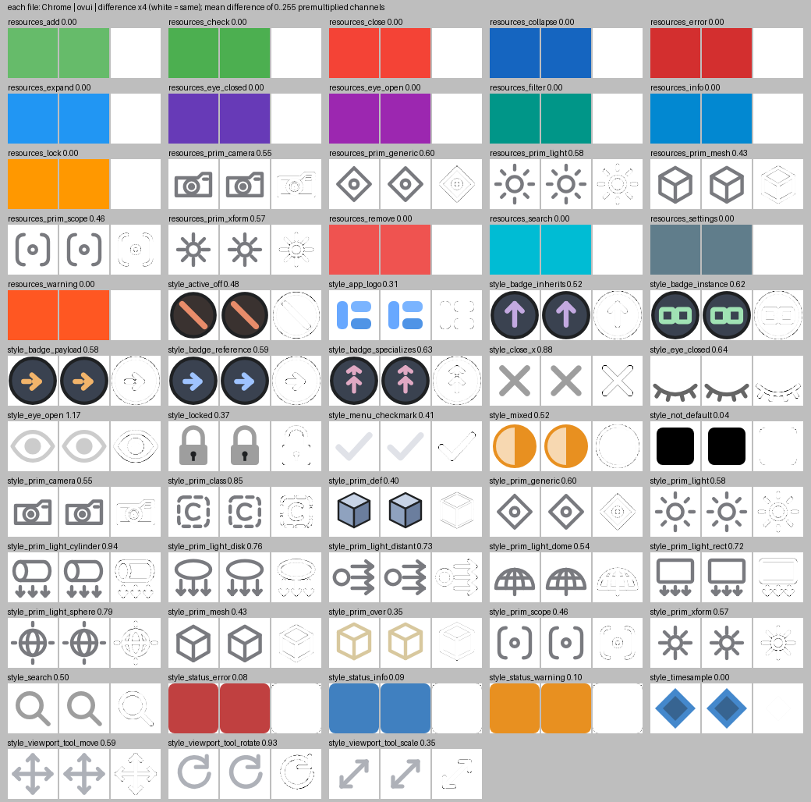

<!--
SPDX-FileCopyrightText: Copyright (c) 2026 NVIDIA CORPORATION & AFFILIATES. All rights reserved.
SPDX-License-Identifier: Apache-2.0
-->

# SVG images in the standalone backend

`ui.Image`, `ui.ImageWithProvider` and `ui.MarkdownWidget` draw `.svg` files
in the standalone backend with the project's own SVG reader and painter
(`standalone/src/StandaloneSvgDocument.h`, `StandaloneSvgDocument.cpp`,
`StandaloneSvgRender.cpp`). No other library is used. The CMake option
`OMNIUI_ENABLE_SVG` (ON by default) builds this code; with the option OFF an
`.svg` image stays empty and logs one error that names the option.

- `ui.Image` and `ui.ImageWithProvider` draw the file at the content size of
  the widget. They make the same request to the SVG rasterizer, so the two
  widgets show the same picture, and images of the same file and size share
  one texture. `ui.Image` takes a local path or a `file://` URL, in its source
  URL or in the `image_url` style.
- `ui.MarkdownWidget` draws an SVG image at the size of the file (the width and
  height of the root `<svg>`, at most 2048 pixels on the longest side), as it
  draws a PNG file. It takes the same SVG text as the other two widgets, also
  with a namespace prefix on the elements (`<s:svg xmlns:s=...>`), from a file
  or from a `data:image/svg+xml;base64,...` URI. Its errors and warnings start
  with "SVG: an image" or "SVG: cannot draw an image" and do not name the
  file, because the widget decodes the bytes of the file.

## What is drawn

- Elements: `<svg>`, `<g>`, `<a>`, `<switch>`, `<use>`, `<symbol>`, `<defs>`,
  `<path>` (all commands, arcs included), `<rect>` (with rounded corners),
  `<circle>`, `<ellipse>`, `<line>`, `<polyline>`, `<polygon>`.
- Paint: colors (hex, `rgb()`, `rgba()`, `hsl()`, `hsla()`, the 148 CSS color
  names, `currentColor`, `transparent`), linear and radial gradients (units,
  spread methods, `gradientTransform`, `href` templates), fill rules.
- Strokes: width, caps, joins, miter limit, dashes and dash offset.
- Transforms, `viewBox` and `preserveAspectRatio`, `opacity` (a group with
  opacity is painted in a layer), `fill-opacity`, `stroke-opacity`,
  `clip-path`.
- Styles: presentation attributes, the `style` attribute and `<style>` sheets
  with type, class, id, `*`, descendant and child selectors.

Not drawn: `<text>`, `<image>`, `<foreignObject>`, `<pattern>` paint, masks,
filters and markers (on any element, the root `<svg>` too), and a `transform`
attribute on an `<svg>` element (the root or a nested one; SVG 2 allows it,
and Chrome applies it). A file with such parts draws its shapes and logs one
warning that names the parts left out.

Drawn differently from the file, with one warning that gives the cause:

- A dash pattern that would cut one path into more than 100,000 dashes is
  drawn as one line with the average cover of its dashes (half the cover for
  `stroke-dasharray="0.0004 0.0004"` with butt caps; full cover when the caps
  close the gaps).
- A path whose data has an error is drawn up to the error, as SVG says. A
  number too small for a double, such as `1e-400`, is 0, as in browsers; a
  number too large, such as `1e400`, is an error of the data.

A file without any shape, a missing, empty or broken file, and a file larger
than 32 MiB draw nothing and log one error with the cause. A file that is not
well-formed XML (for example a raw `<` in an attribute value, `--` in a comment,
or `<!` that is not one `<!DOCTYPE>` before the root element) is refused, and
the error gives the line, the column and the cause. An exception while a file
is read or painted, for example `std::bad_alloc`, is caught: the image stays
empty and the cause is logged. The same error or warning of a URL is logged
once; after the URL draws without it, it is logged again when it comes back.

## Limits

A small file must not take unbounded time or memory on the UI thread. The
reader and the painter count their work before they do it, and refuse a file
that needs more than one of these limits; the error names the limit
("the SVG is too complex to draw: ..."):

| What is counted | Limit |
|---|---|
| Text that entity references add | 1 MiB in total |
| XML elements; XML attributes | 1,000,000; 4,000,000 |
| Groups and shapes (clip shapes too) when `<use>` references are followed | 100,000 |
| Path points when `<use>` references are followed | 4,000,000 |
| Selector and declaration pairs of all `<style>` rules | 100,000 |
| Selector tests and declarations applied while styles are computed, and bytes of `style` attributes parsed | 10,000,000 |
| Stops of one gradient | 4,096 |
| Line pieces of curves, dashes, joins and caps | 4,000,000 |
| Pixels visited while painting (shapes, clips, layers) | 64 times the bitmap, at least 16,777,216 |
| Memory of the group layers that exist at the same time | 256 MiB |

Parts nested deeper than 256 levels of groups, `<svg>` and `<use>` references
are not drawn and are reported (a chain of 40 `<use>` draws, as in Chrome; a
`<use>` that refers to itself is reported as such). Selectors are matched
without backtracking: each chain of parts joined by `>` is matched at the
nearest ancestor where it matches, so a selector over many nested groups costs
a walk up the ancestors, not every way to place its parts. The work of the
`style` attribute (its parse, sort and apply) counts the same way, so a `<use>`
that repeats an element with a large `style` attribute cannot multiply it.

The corpus and the icons of ovui-widgets need at most 2.9 times the bitmap in
pixel visits (2.8 at 2048 x 2048) and 2,323 line pieces (at 2048 x 2048). A
file just under the pixel limit at 2048 x 2048 (60 shapes with transparency
that each cover the whole bitmap) takes 0.25 s to paint.

The limits bound the work, but the work up to a limit is still done before the
file is refused. In USD Viewer a 46 KB file whose `style` attribute of 5,000
declarations is repeated by 20 levels of two `<use>` made one frame of about
0.4 s before it was refused; the frames after it were normal.

## Comparison with Google Chrome

`standalone_svg_rasterizer_tests` paints every file of `tests/svg_corpus/` and
compares the pixels with the picture that Google Chrome 155 makes of the same
file (`tests/svg_corpus/chrome/`, made by
`tests/svg_corpus/make_chrome_pictures.py`: Chrome draws the file into a canvas
of 128 pixels, 64 for `icons/`). The difference is taken on premultiplied
channels, 0 to 255. For each file the mean must be at most 1.5, and at most
0.25% of the pixels may differ by more than 96 (0.75% for `stroke_dash` and
`gradient_linear`; see below).

| File | What it covers | Mean | Pixels > 96 |
|---|---|---|---|
| `clip_path` | clip paths: user space, bounding-box units, `clip-rule` | 0.11 | 0.00% |
| `clip_use_style` | a `<use>` in a clip path keeps its own `clip-rule` | 0.00 | 0.00% |
| `clip_rule_inherited` | a `clip-rule` that a clip path inherits from its ancestors | 0.06 | 0.00% |
| `colors` | hex, `rgb`, `rgba`, `hsl`, `hsla`, names, `currentColor` | 0.00 | 0.00% |
| `fill_rule` | nonzero and even-odd, nested contours | 0.03 | 0.00% |
| `gradient_current_color` | `currentColor` and `inherit` in gradient stops: the color of the root, a group, the gradient, the stop, a template | 0.17 | 0.00% |
| `gradient_linear` | linear gradients, units, spread, `href`, transform | 0.51 | 0.40% |
| `gradient_opacity` | stop opacity, mixed colors and alpha | 0.18 | 0.00% |
| `gradient_radial` | radial gradients, focal point, spread, transform | 0.23 | 0.00% |
| `icon_mixed` | an exported icon: prolog, comment, `style`, relative paths | 0.34 | 0.00% |
| `named_colors` | all 148 CSS color names | 0.06 | 0.00% |
| `opacity` | `fill-opacity`, `stroke-opacity`, element and group opacity | 0.37 | 0.00% |
| `path_arcs` | arcs: flags, rotation, radii that grow | 0.40 | 0.00% |
| `path_commands` | all path commands, absolute and relative, number syntax | 0.34 | 0.00% |
| `shapes_basic` | rect, rounded rect, circle, ellipse, line, polyline, polygon | 0.28 | 0.00% |
| `stroke_caps` | butt, round and square caps, dots | 0.04 | 0.00% |
| `stroke_curves` | thick strokes on curves, a loop | 0.49 | 0.00% |
| `stroke_dash` | dash arrays, offsets, dashes on curves | 1.13 | 0.52% |
| `stroke_joins` | miter, round and bevel joins, miter limit | 0.24 | 0.00% |
| `stroke_transform` | strokes under scale, skew and matrix | 0.16 | 0.00% |
| `style_css` | `<style>` selectors, `style` attribute, precedence | 0.14 | 0.00% |
| `style_selector_chains` | descendant and child chains that skip the nearest match; a selector over 14 nested groups | 0.00 | 0.00% |
| `transforms` | translate, rotate, scale, skew, matrix, nesting | 0.20 | 0.00% |
| `use_defs` | `<use>`, `<defs>`, `<symbol>` with `viewBox` | 0.18 | 0.00% |
| `viewbox_aspect` | `viewBox` with another aspect ratio | 0.10 | 0.00% |
| 58 icons of ovui-widgets (`icons/`) | the icons of the issue | 0.00 to 1.17 (average 0.39) | 0.00% to 0.15% |

Each image below shows, for each file, the Chrome picture, the ovui picture and
their difference times four (white is the same).

The remaining differences are at antialiased edges. Chrome computes the
coverage of edge pixels in its own way; ovui uses the exact area of each pixel
that the shape covers. Chrome also places short dashes on curves a little
differently (`stroke_dash`) and samples the seam of a repeated gradient at
another pixel (`gradient_linear`).

## Speed

An SVG icon is read, parsed and painted on the UI thread when it is first
shown. Its texture is shared by every image of the same file and size, and a
later image of the same file and widget size gets it without reading the file
again, as cached PNG files do.

Measured with `-O3` on one x86-64 core, for the 58 icons of ovui-widgets: the
SVG file is read, parsed, painted and freed; a PNG of the same picture and size
(made by Google Chrome) is read, decoded with stb_image (the decoder of the
standalone PNG loader) and freed. Both files are in the same folder. Each value
is the average over the icons of the fastest of 300 runs, and the mean of 10
rounds.

| Bitmap size | SVG | PNG of the same picture and size | SVG / PNG |
|---|---|---|---|
| 32 x 32 (a 16 pixel icon) | 8.4 us | 9.4 us | 0.89 |
| 64 x 64 | 11.9 us | 14.1 us | 0.85 |
| 128 x 128 | 20.9 us | 26.2 us | 0.80 |

Icon by icon the ratio goes from about 0.5 to 1.4: an icon with many thin
strokes and round joins takes longer than its PNG, a simple one less.

The counting of the work limits (see Limits) costs time. Measured the same way
against an earlier version of this code with fewer limits, an icon took 1.1%
more time at 32 x 32, 1.2% more at 64 x 64 and 2.8% more at 128 x 128 (0.09 to
0.57 us), and the 2048 x 2048 bitmaps below took 3.7% more (0.09 ms). Other runs
of the same measurement gave 1.0 to 1.6% at 32 x 32 and 64 x 64.

A 1024 pixel widget is painted into a 2048 x 2048 bitmap. For 5 icons of
ovui-widgets this takes 2.6 ms on average, against 7.6 ms to decode a PNG of the
same picture and size. In USD Viewer with windowed Vulkan (three sessions), the
frame in which such an image appears took 38 to 42 ms for the SVG file and 43 to
46 ms for a 2048 pixel PNG of the same picture at the same widget size (other
frames 11 to 20 ms); with windowed OpenGL, 29 ms for the SVG file and 53 ms for
the PNG. Painting the SVG is 2.6 ms of that frame; the rest is the first load of
a 2048 x 2048 image, which the PNG needs too.

In USD Viewer with a large scene and windowed Vulkan (three sessions), the
longest frame after a click that shows 58 icons of 48 pixels in a list (about 10
of them in view) took 26 to 28 ms with the SVG files and 26 to 29 ms with PNG
files of the same pictures, and 21 ms when the same SVG files were shown again.
The first click that loads images in a session (4 SVG icons and 1 PNG icon)
took 19 to 25 ms. In two of the three sessions one frame took 0.2 to 0.3 s,
once, at a click that loaded new images: at the 58 SVG icons in one session and
at the 2048 pixel PNG in the other. It did not come back when the same files
were loaded in the other sessions, and a PNG file had it too, so it is not
specific to SVG files.
